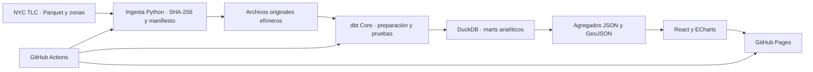

# CityTrips NYC — plan e implementación

**Actividad Individual I · Inteligencia de Negocios**

Construiremos un producto público de ingeniería de datos con datos reales de viajes de taxi amarillo de la NYC Taxi and Limousine Commission (TLC). El sitio responderá cómo cambia la demanda por mes, distrito, zona y hora; mostrará duración y distancia; y hará visible la cobertura del cargo por congestión. El repositorio, el pipeline automatizado y el tablero forman una entrega reproducible, no solo una maqueta.

## Alcance y decisiones

- **Datos:** archivos mensuales Parquet desde enero de 2024, catálogo de zonas y límites geográficos oficiales. El flujo detecta los meses publicados en la página de TLC; si la página bloquea a Actions, verifica la secuencia mensual en los archivos públicos de CloudFront que TLC enlaza. Los datos de origen permanecen fuera de Git.
- **Cambio de esquema real:** el campo `cbd_congestion_fee` no está presente en registros antiguos. La capa de preparación normaliza ambos esquemas. Un valor ausente se conserva como desconocido y se distingue de cero.
- **Pipeline:** Python descarga y verifica archivos, dbt Core modela los datos y DuckDB ejecuta el almacén analítico. La salida pública contiene solamente agregados, métricas de calidad y geometrías de las zonas.
- **Automatización y nube pública:** GitHub Actions ejecuta CI en los cambios y actualiza GitHub Pages en un horario mensual o bajo demanda. La aplicación es estática, pública por HTTPS y no requiere mantener una máquina virtual encendida.
- **Interfaz:** React, TypeScript y ECharts presentan demanda, comparación temporal, mapa de zonas y calidad de los datos. La serie marca el inicio del programa de cargos el 5 de enero de 2025; la comparación es descriptiva y no atribuye causalidad.

### Flujo técnico

La publicación ocurre solo si finalizan correctamente la descarga, las pruebas de dbt y la compilación del sitio. El despliegue de Pages reemplaza el sitio como una versión única; un fallo del pipeline deja visible la última versión publicada. Los workflows reciben únicamente los permisos necesarios para leer el repositorio y publicar Pages.

## Fases de trabajo

Cada fase termina con pruebas apropiadas y un commit identificable.

| Fase | Entrega | Validación |
| --- | --- | --- |
| 0. Fundamentos | Repositorio, plan, alcance, dependencias fijadas y guía de contribución. | Instalación limpia y estructura documentada. |
| 1. Ingesta | Descubrimiento del catálogo, descarga concurrente y atómica, validación de Parquet/ZIP, SHA-256 y manifiesto de procedencia. | Pruebas de extracción de enlaces, archivo inválido, reintentos y manifiesto. |
| 2. Almacén | Modelos dbt de staging, hechos y marts mensuales, horarios, zonas y calidad. | `dbt build` sobre muestras con ambos esquemas; idempotencia y conciliación de filas. |
| 3. Producto | Dashboard adaptable a escritorio y móvil, mapa, filtros, indicadores, estados de carga/error y datos de muestra para desarrollo. | Pruebas de selectores, controles y compilación de producción. |
| 4. Automatización | CI de Python/dbt/frontend; actualización programada y manual hacia GitHub Pages. | Workflows pasan; despliegue público confirmado y datos reales sustituyen la muestra. |
| 5. Difusión | Guías/artículos individuales, video público menor a cinco minutos y ZIP de enlaces. | Enlaces accesibles sin iniciar sesión y duración comprobada. |

### Calidad e idempotencia

- El manifiesto registra URL, mes, filas, columnas y checksum de cada archivo. La descarga se escribe en un temporal y se renombra al finalizar la validación.
- Las pruebas de dbt cubren meses, llaves de zona, fechas, duración, distancias, cobertura del cargo y la relación `filas de origen = filas aceptadas + filas rechazadas`.
- Una recarga empieza en un espacio limpio de Actions y reconstruye los resultados desde la fuente; por tanto, no acumula filas de ejecuciones anteriores.
- Si una fuente no está disponible, los datos no se pueden leer, falla una prueba o no compila el frontend, Pages no recibe artefacto nuevo.
- Los resultados son agregados. No publicar registros individuales de viajes ni información que no sea necesaria para contestar las preguntas del tablero.

## Artículos y video

Cada integrante debe publicar desde su propia cuenta en Medium, DEV Community o Hashnode un artículo basado en una parte que haya construido o pueda explicar. Los temas pueden dividirse según el tamaño real del equipo:

1. Ingesta reproducible: catálogo público, Parquet, descargas seguras, checksums y manifiesto.
2. Evolución de esquema: cómo dbt y DuckDB integran el campo de cargo que aparece en los datos recientes.
3. Calidad analítica: granularidad, validaciones, rechazo de registros e idempotencia con pruebas pequeñas.
4. Dashboard de datos: agregaciones, mapas, comparaciones temporales y comunicación de incertidumbre.
5. Automatización pública: CI/CD con GitHub Actions, artefactos estáticos y despliegue a Pages.

Los artículos deben incluir una explicación original, fragmentos del repositorio, instrucciones reproducibles y enlaces al código y al dashboard. Evitar afirmaciones causales sobre los cambios de demanda.

**Guion de video (4:40 máximo):**

| Tiempo | Escena |
| --- | --- |
| 0:00–0:20 | Pregunta de negocio y vista final del dashboard. |
| 0:20–0:55 | TLC como fuente, diagrama de arquitectura y cambio real del esquema. |
| 0:55–1:40 | Descarga, manifest, checksums y datos fuera del repositorio. |
| 1:40–2:30 | Modelos dbt, controles de calidad y recarga repetible. |
| 2:30–3:25 | Mapa, tendencias, cobertura del cargo y lectura prudente de las cifras. |
| 3:25–4:10 | GitHub Actions y despliegue automático a Pages. |
| 4:10–4:40 | Hallazgo descriptivo, repositorio, demo y artículos del equipo. |

Grabar las pantallas con texto legible, agregar subtítulos y comprobar visibilidad pública y duración antes de compartir.

## Criterios de cierre y entrega

- [ ] Repositorio público clonable con dependencias y pasos de ejecución documentados.
- [ ] CI y workflow de publicación exitosos en GitHub Actions.
- [ ] Dashboard público muestra datos TLC actualizados y las cuatro vistas analíticas.
- [ ] Cada miembro aporta el enlace a su artículo público.
- [ ] Video público de menos de cinco minutos.
- [ ] Compartir los enlaces en el grupo de Telegram.
- [ ] Crear `Entrega_Actividad_Individual_I.zip` con `Enlaces.txt`: autores, artículos, video, repositorio, dashboard y, opcionalmente, ejecución de publicación. Abrir los enlaces en una ventana privada y subir el ZIP a la tarea.

## Fuentes

- [NYC TLC — datos de viajes y diccionarios](https://www.nyc.gov/site/tlc/about/tlc-trip-record-data.page)
- [MTA — programa de cargo por congestión](https://www.mta.info/document/165006)
- [dbt — pruebas de datos](https://docs.getdbt.com/docs/build/data-tests)
- [GitHub Pages — despliegue mediante Actions](https://docs.github.com/en/pages/getting-started-with-github-pages/using-custom-workflows-with-github-pages)
