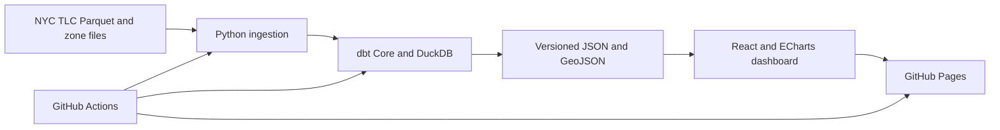

# CityTrips NYC

CityTrips NYC is a public data engineering project that turns NYC Taxi and Limousine Commission (TLC) yellow taxi trip records into a tested, interactive dashboard. It uses Python for ingestion, dbt Core with DuckDB for analytics, GitHub Actions for scheduled automation, and GitHub Pages for public hosting.

The project compares trip demand, duration, distance, and reported congestion fees from January 2024 through the latest complete month published by TLC. TLC added `cbd_congestion_fee` to the yellow taxi records starting in 2025, making schema evolution part of the pipeline rather than a simulated exercise.

## Architecture



Raw Parquet files are downloaded into the workflow workspace and are never committed. Ingestion reads the TLC data page and, when that page blocks an automation runner, discovers the latest month from the same public CloudFront files linked by TLC. It checks the complete month sequence before processing. The scheduled workflow restores source files from the Actions cache, checks upstream HTTP validators and SHA-256, then downloads only new or changed months. A cache miss or unsupported validators safely falls back to downloading the source. The public site contains only monthly and zone-level aggregates, quality results, and taxi zone boundaries. If ingestion, a data test, or the site build fails, Pages receives no new version and the last successful dashboard remains available.

## Local development

Requirements are Python 3.12 or 3.13, `uv`, and Node.js 22.

```powershell
uv sync --all-groups
uv run pytest
uv run ruff check .
```

```powershell
Set-Location web
npm ci
npm test
npm run lint
npm run build
```

To run the full refresh locally (this downloads all TLC history from 2024 onward on the first run):

```powershell
Set-Location ..
uv run citytrips-refresh --start-year 2024 --output web/public/data
```

Use `--force-download` to fetch every published Parquet file again. Local UI data is marked **Illustrative local sample data** until a refresh replaces it with the published TLC aggregates.

## Continuous integration and publishing

- `.github/workflows/ci.yml` runs Python lint/tests and dashboard lint/tests/build on pushes and pull requests to `main`.
- `.github/workflows/publish.yml` performs a full data refresh and deploys to GitHub Pages on request and monthly on the 10th at 10:15 Lima time.
- The publish workflow caches only validated raw source files. When source validators change, the checksum differs, or a cache is unavailable, ingestion downloads and validates the file again.
- GitHub Pages must be enabled with **GitHub Actions** as the build source. Repository Actions permissions are read-only except the Pages deployment job's narrowly scoped `pages:write` and `id-token:write`.

## Data source and interpretation

TLC publishes monthly Parquet trip records and the taxi zone lookup and boundary files on its public data page. Trip counts and fees are descriptive. The dashboard marks 2025-01-05, the start of congestion pricing, without presenting the comparison as a causal estimate.

- [NYC TLC trip record data](https://www.nyc.gov/site/tlc/about/tlc-trip-record-data.page)
- [MTA congestion pricing program](https://www.mta.info/document/165006)

## Public deliverables

- Repository: https://github.com/iovargasjeff/citytrips-nyc
- Dashboard: https://iovargasjeff.github.io/citytrips-nyc/
- [Extended Spanish technical article with architecture diagrams and dashboard screenshots](docs/articulo-dev-es.md)
- [Spanish construction-video script and scene plan](docs/guion-video-es.md)
- Construction video: rendered locally at 1920×1080; add the public platform URL after publication

The video can be re-rendered on Windows with Pillow, FFmpeg/FFprobe and an installed Spanish
System.Speech voice: `py -m pip install Pillow`, then `py tools/render_video.py` from the project
root. Generated media is kept in the ignored `deliverables/` directory and is not added to the
source repository.

## License

The code is available under the MIT License. NYC TLC data remains subject to its source terms and attribution. The data does not contain passenger names or contact details, and the pipeline publishes aggregate statistics only.
